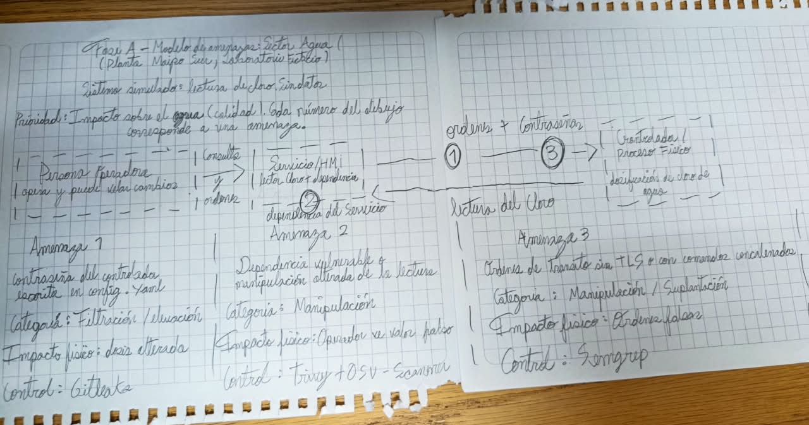
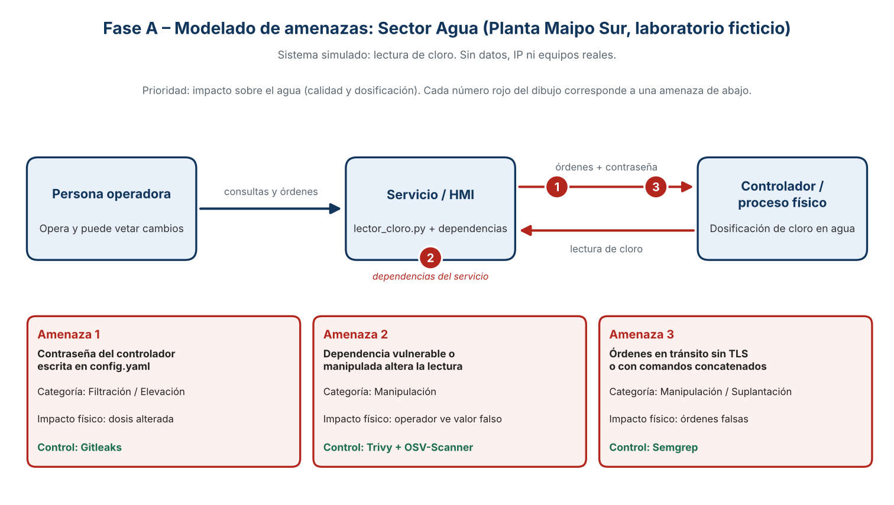

# Ficha de blindaje

## 1. Sistema y equipo
- Sector: Agua
- Nombre: Planta Maipo Sur (laboratorio ficticio, lectura de cloro)
- Equipo: Gibran Escobar, Benjamín Zepeda y José Villasmil
- Roles (5 roles entre 3 personas):
  - Operador de planta: Benjamín Zepeda
  - Desarrollador: José Villasmil
  - Guardián del pipeline: Gibran Escobar
  - Auditor de IA: Benjamín Zepeda
  - Relator: José Villasmil

## 2. Diagrama
Dibujo hecho a mano por el equipo (sin datos reales): `evidencias/diagrama_a_mano.jpg`

Versión digitalizada del mismo modelo: `evidencias/diagrama.png`

Persona operadora → servicio/HMI (`lector_cloro.py`) → controlador / proceso físico (dosificación de cloro)

## 3. Amenazas
| # | Amenaza | Categoría (STRIDE) | Impacto físico | Control que la detecta |
|---|---------|--------------------|----------------|------------------------|
| 1 | La contraseña del controlador está escrita en `config.yaml`; cualquiera con acceso al repositorio puede usarla | Filtración / Elevación de privilegios | Alguien podría cambiar la dosis de cloro y afectar la calidad del agua | Gitleaks |
| 2 | Una dependencia vulnerable o manipulada en el servicio HMI altera la lectura de cloro que ve el operador | Manipulación | El operador decide con un valor falso (dosis de más o de menos) | Trivy + OSV-Scanner (SBOM) |
| 3 | Comunicación servicio → controlador sin validar TLS o con comandos armados con texto concatenado | Manipulación / Suplantación | Se podrían inyectar órdenes falsas al controlador | Semgrep |

## 4. Controles
- Enlace a Actions: https://github.com/jvillasmilv22-byte/planta-maipo-sur-template/actions/runs/38804750128 (ejecución #10, verde, commit `cddfe1b`)
- Controles ejecutados:
  - Gitleaks (código propio): aprobado en la ejecución #10
  - Semgrep (código propio): aprobado en la ejecución #10
  - Trivy dependencias + OSV-Scanner (código prestado): aprobados en la ejecución #10
  - Trivy configuración: aprobado en la ejecución #10; el sector Agua no tiene carpeta `infra/`, por lo que no hay nada que analizar
  - SBOM `sbom.cdx.json` cargado como artefacto `sbom`: sí (aparece en los artefactos de la ejecución #10)

## 5. Hallazgo y decisión
- Hallazgo: Gitleaks, regla `credencial-laboratorio-plc`, en `config.yaml` línea 1 (commit `d12bb70`): credencial de fábrica escrita directamente en el archivo (el valor no se copia en esta ficha). Detectado en la ejecución #2 de `seguridad-planta`, que terminó en rojo. Enlace: https://github.com/jvillasmilv22-byte/planta-maipo-sur-template/actions/runs/37979875134
- Gravedad: Alta (en una planta real sería Crítica: da acceso de control al proceso)
- Decisión y justificación: **Corregir ahora.** Se retiró el valor del archivo y se dejó `password_env: PLC_PASSWORD`; el valor real vive en el secreto de GitHub `PLC_PASSWORD`. La aplicación lo lee por variable de entorno y no lo imprime. Corrección: commit `045c537` ("Retirar credencial del código y usar secreto"). Validación: las ejecuciones #6 a #10 terminaron en verde.
- Rotación (simulada): la credencial de fábrica se considera comprometida desde que estuvo en el repositorio. Se registra su reemplazo por una nueva en el secreto `PLC_PASSWORD`. Fecha: 15-10-2026. El valor anterior sigue en el historial de commits, por lo que en un sistema real también habría que revocarlo y limpiar el historial.
- Responsable y fecha: José Villasmil · 15-10-2026

## 6. Parche de IA (Propuesta #7 – "arregla la lectura del controlador")
Pull request revisado, sin fusionar: https://github.com/jvillasmilv22-byte/planta-maipo-sur-template/pull/1 (PR de práctica creado por el equipo según el Anexo A.12 de la guía, porque el facilitador no estaba disponible). Archivo cambiado: `lector_cloro.py` (+21 −2).

- Paquete verificado: **No.** La línea 6 importa `plc_helper_utils` (`from plc_helper_utils import normalizar_lectura`). Ese paquete no está en el repositorio ni en `requirements.txt`, y **no existe en el registro oficial (PyPI)**. Evidencia (15-10-2026): la búsqueda de `plc_helper_utils` en pypi.org no muestra ningún resultado con ese nombre exacto (`evidencias/pypi_busqueda.png`) y la dirección https://pypi.org/project/plc-helper-utils/ devuelve error 404 (`evidencias/pypi_404.png`). Un paquete inexistente suele ser un nombre inventado por la IA; si alguien lo registrara después con código malicioso, el parche lo instalaría sin que nadie lo note.
- Tratamiento de entradas: **Inseguro.** La línea 16 hace `subprocess.run("echo lectura " + canal, shell=True, ...)`: une texto recibido (`canal`) a un comando y lo ejecuta en la shell, por lo que se podrían inyectar comandos.
- Protecciones desactivadas: **Sí.** La línea 23 usa `requests.post(TELEMETRIA, json=lectura, verify=False)`: `verify=False` desactiva la validación del certificado TLS.
- Destino de datos: **No justificado.** La línea 8 define `TELEMETRIA = "https://telemetria.example.invalid/api/lecturas"` y la línea 23 le envía la lectura. No hay autorización, justificación ni explicación de por qué los datos salen de la planta.
- Veredicto y evidencia: **RECHAZAR el parche en su estado actual.** Que funcione no basta: combina paquete no verificado, ejecución de shell con entrada concatenada, TLS desactivado y salida de datos injustificada. Evidencia: pestaña Files changed del pull request #1, líneas 6, 8, 16 y 23. El pull request no se fusionó.
- Explicación para el operador (redactada con IA y revisada por el equipo): "Este parche ejecuta comandos armados con texto externo y envía las lecturas de cloro a un servidor sin comprobar que sea el verdadero, además de usar un paquete que no pudimos verificar. Si alguien lo aprovecha, la lectura de cloro que usted ve podría ser falsa o quedar expuesta, y en una planta real eso podría llevar a ajustar la dosis con datos equivocados."

## 7. Pendientes para un sistema real
- Rotar y revocar la credencial real, revisar accesos y limpiar el historial de Git con un procedimiento controlado.
- Usar un gestor de secretos con rotación automática en lugar de un secreto estático.
- Revisar todo el historial con Gitleaks, no solo el estado actual.
- Segmentar la red entre HMI y controlador; autenticar y registrar cada orden.
- Mantener inventario SBOM actualizado y revisar dependencias en cada cambio.
- Exigir revisión humana y de seguridad antes de aceptar cualquier cambio generado por IA.

## 8. Reproducción
- Workflow: `seguridad-planta` (pestaña Actions → Run workflow, rama `main`)
- Enlace: https://github.com/jvillasmilv22-byte/planta-maipo-sur-template/actions/workflows/seguridad.yml
- Equivalentes locales:
  - `gitleaks detect --no-git --source .`
  - `semgrep scan --config .semgrep.yml --error .`
  - `trivy fs --scanners vuln .`
  - `trivy config .`
  - `python scripts/prueba_funcional.py`
